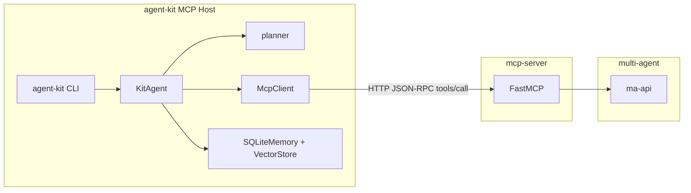
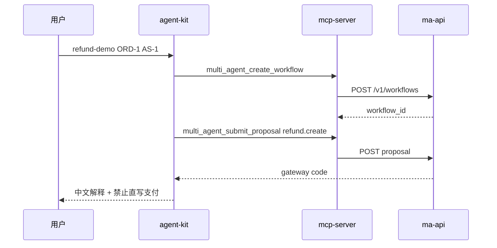

# Design: agent-kit P1

> 与 [proposal.md](./proposal.md) 同步

## 1. 架构（MCP Host 视角）



**原则：** `KitAgent` 不 import `view_agents_mcp` 包（避免 PyCharm 路径耦合）；仅 **HTTP/契约 JSON** 对话。

## 2. McpClient（P1）

| 项 | 选择 |
|----|------|
| 模块 | `src/agent_kit/mcp_client.py`（`mcp_bridge.py` 保留薄 re-export 兼容测试） |
| 契约 | 默认 `../../mcp-server/contracts/unified_socket.json`（相对 `agent-kit` 根可配置） |
| 缓存 | 进程内 `catalog: list[dict]`，`list_tools` 失败时用契约 fallback |
| 方法 | `ping()`、`catalog(plug_id?)`、`describe(name)`、`call(name, args)` |
| 鉴权 | `Authorization: Bearer` 当 `MCP_HTTP_BEARER_TOKEN` 设置 |

```python
# 伪代码
class McpClient:
    def call(self, name: str, arguments: dict | None = None) -> dict:
        if self.offline:
            return OFFLINE_STUBS.get(name, {"error": "unknown_tool"})
        return self._post_tools_call(name, arguments)
```

**离线 stub：** 与 P0 `mcp_tools_call(..., offline=True)` 行为兼容，扩展 `multi_agent_health` 返回 `configured: false`。

## 3. LLM 规划

| 项 | 选择 |
|----|------|
| 触发 | CLI `--llm` 或 env `AGENT_KIT_USE_LLM=1` |
| 模型 | `ChatOpenAI`，`settings.json` → `llm.temperature` |
| Prompt | `system.md` + `render_task(goal, context)` + JSON schema 说明 |
| 解析 | `json.loads` 提取 `steps[]`；失败 **一次** 重试后回落 `plan_demo` |
| 测试 | `unittest.mock` patch `ChatOpenAI.invoke` 返回固定 JSON |

`PlanStep` 字段不变：`index`, `description`, `kind`, `target`, `arguments`。

## 4. refund-demo 链路



CLI 参数对齐 `unified_socket.json` 中 tool 参数名；`base_url` 默认 env `MULTI_AGENT_API_URL`（经 MCP bridge 配置）。

## 5. 记忆增强

- 启动 `KitAgent` 时将 `examples.md` 分块 `vector_store.add`
- `run()` 前 `vector_store.search(goal, k=2)` 注入 `render_task` 的 `context`
- 新命令 `memory-search`：只读检索，不写 SQLite

## 6. 测试分层

| 层 | 命令 | 说明 |
|----|------|------|
| 离线 | `pytest -q`（默认） | mock LLM + offline MCP |
| 集成 | `pytest -q -m live` | 需 `ma-api` + `view-agents-mcp-http` |
| CI | 仅离线层 | 与现有三项目 job 并列 |

## 7. 配置扩展

`settings.json` 新增：

```json
{
  "mcp": {
    "contract_path": "../mcp-server/contracts/unified_socket.json",
    "timeout_seconds": 30
  },
  "planner": {
    "default": "rule",
    "llm_env": "AGENT_KIT_USE_LLM"
  }
}
```

`config.py` 解析 `contract_path` 为绝对路径（相对 `agent-kit` 根）。