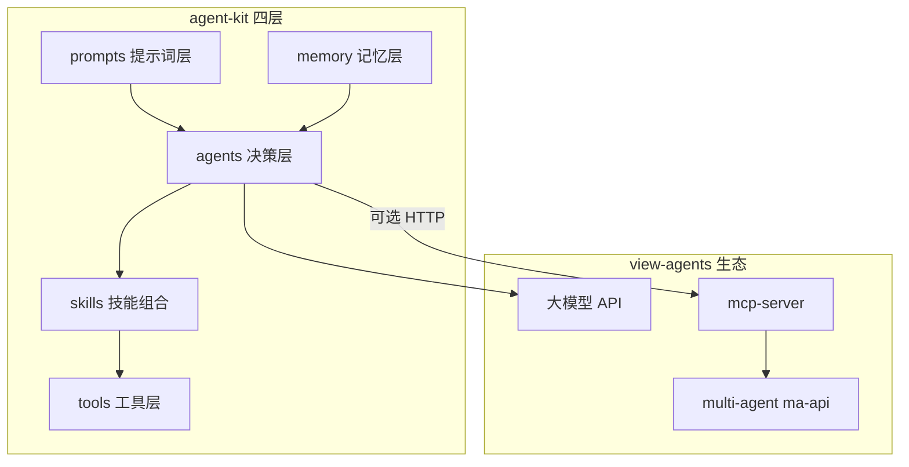

# Explore: agent-kit（并列第四项目 — 0→1 Agent 全流程）

> **Change id:** `explore-fullstack-agent`  
> **模式:** `/opsx:explore`  
> **对照教材:** 提示词 / 智能体 / 大模型 / MCP / Multi-Agent 生态 / 数据分析实战

## 探索结论

**P0 + P1 已 apply：** 见 [proposal.md](./proposal.md)、[tasks.md](./tasks.md)（全勾选）。P2 backlog：stdio MCP Client、Chroma、A2A 文档。

## 1. 与三项目分工

| 项目 | 教材对应 | 本探索中的角色 |
|------|----------|----------------|
| `langgraph-agent` | ReAct / 单图循环 | **参考实现**；不重复造图 |
| `multi-agent` | 执行真相 / Gateway | MCP + `multi_agent_*` 的 REST 后端 |
| `mcp-server` | MCP 连接标准 | **工具面**；`agent-kit` 作 MCP Host Client |
| **`agent-kit`** | 0→1 搭建全流程 | **教学 + 可扩展骨架**；YAML 配置 Agent、skills 组合 tools |

## 2. 教材 8 步 → 目录映射

| 步骤 | 教材产物 | `agent-kit` 路径 |
|------|----------|------------------|
| 1 初始化 | `codex init my-agent` | 根目录 + `pyproject.toml` + CLI `agent-kit` |
| 2 配置 | `.env.example` / `settings` | `env.example`、`settings.json`、`config.py` |
| 3 结构 | agents/skills/tools/memory/prompts | 同名列 + `src/agent_kit/` 包 |
| 4 定义 Agent | `agent.yaml` + `agent.py` | `agents/agent.yaml`、`agents/agent.py` |
| 5 工具 | search / calculator / api-client | `tools/*.py` |
| 6 技能 | 分析 / 报告 / 代码解释 | `skills/*.py` |
| 7 记忆 | base / vector / history | `memory/base.py`、`vector_store.py`、SQLite |
| 8 提示词 | system / task / examples | `prompts/*.md` + `prompt_loader.py` |

## 3. 概念对照（教材插图）

### 3.1 提示词 — 指令与控制

- **角色：** 用户与 LLM/Agent 的「沟通语言」
- **实现：** `prompts/system.md` 定角色；`task.md` 任务模板；`examples.md` few-shot

### 3.2 智能体 — 规划 / 记忆 / 工具调用

- **规划：** `planning.py` 将目标拆为 `PlanStep` 列表（规则 + 可选 LLM）
- **记忆：** `memory/base.py` 会话窗口 + `history.db` 长期摘要
- **工具：** `ToolRegistry` 注册 `tools/*`，Agent 按 plan 调度

### 3.3 大模型 — 核心引擎

- 通过 `langchain-openai`（与 `langgraph-agent` 一致）可插拔；**测试默认 mock planner**

### 3.4 MCP — 标准化连接

- `mcp_bridge.py`：HTTP 调 `view-agents-mcp-http` 或进程内测试 stub
- 与教材 **MCP Host → Client → Protocol → Server → DB/FS** 对齐；本仓 Server = `mcp-server`

### 3.5 Multi-Agent 生态

- 单体 Agent 内：LLM + Planning + Memory + Tools（内圈）
- 外圈：经 MCP 调用 `multi_agent_*`（与 langgraph `USE_MULTI_AGENT_TOOLS` 同契约）

### 3.6 数据分析实战（教材第五图）

- `AnalysisTask` dataclass；`DataAnalysisAgent` 组合 `DataProcessor`、`ModelManager`、`VisualizationEngine`、`ReportGenerator`
- CLI：`agent-kit analyze --csv sample.csv`

## 4. P0 范围（本 apply）

- 完整目录与可运行 CLI（`run` / `analyze` / `mcp-ping`）
- 单元测试：工具、记忆、规划、数据分析管道（无真实 API Key）
- 文档 `docs/agent-stack-map.md` 链到 monorepo 三项目

## 5. P1（非阻塞）

- 真实 LLM 规划回路默认开启、`mcp` stdio 子进程 Client
- 向量库换 Chroma / pgvector
- OpenSpec `propose` 归档后对接 CI 与教案 PDF 导出

## 6. 风险

| 风险 | 缓解 |
|------|------|
| 与 `langgraph-agent` 功能重叠 | `agent-kit` 偏 **教学骨架** + YAML；LangGraph 偏 **图执行** |
| MCP 依赖未启动 | `mcp-ping` 离线 mock；文档写明先起 `ma-api` + MCP |
| 向量依赖重 | P0 用内存向量 + SQLite 历史 |