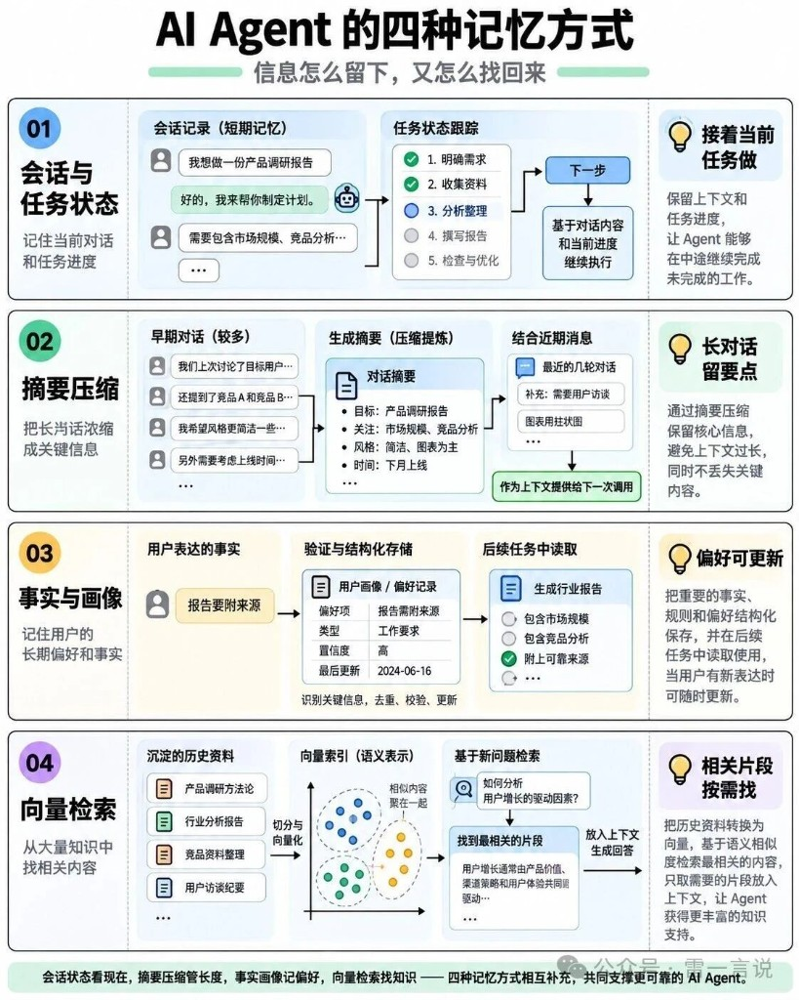
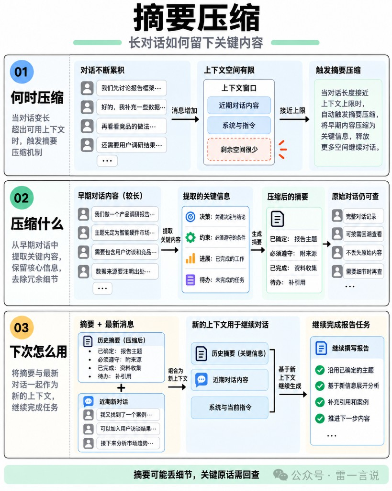
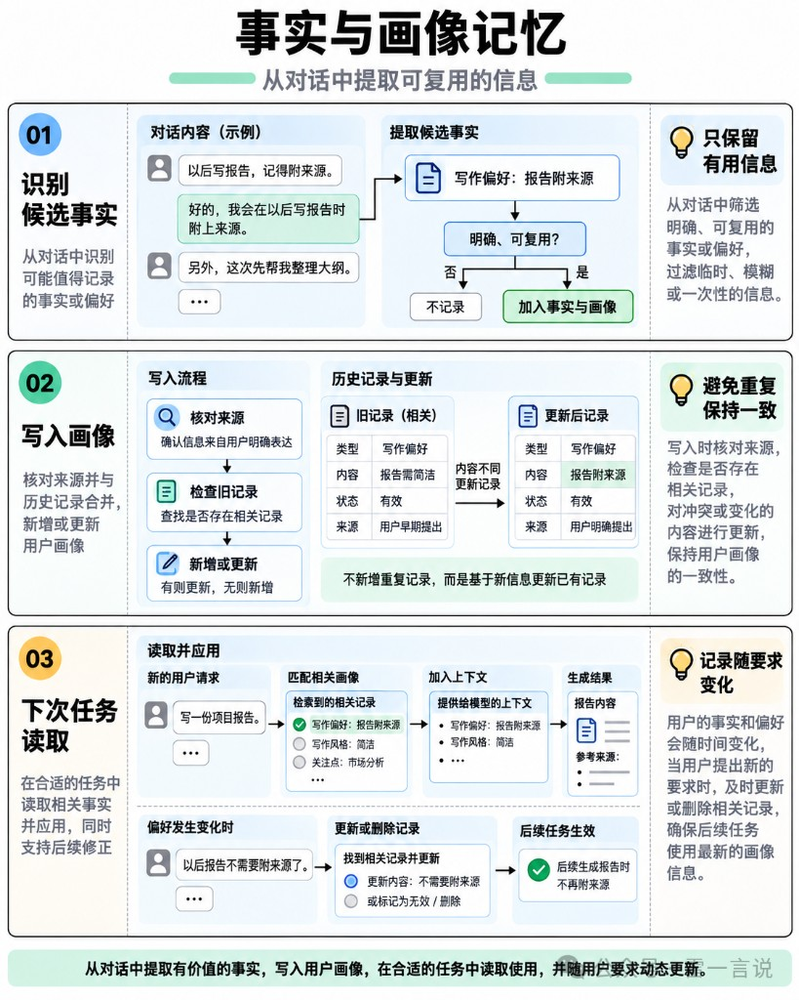
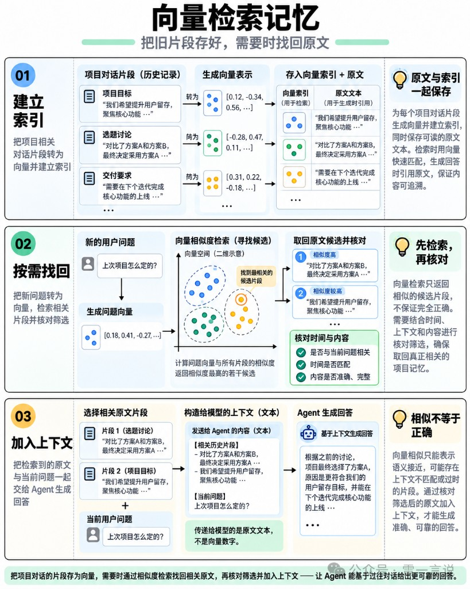
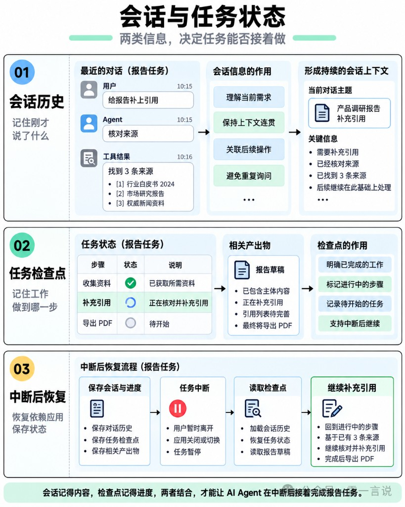

# Agent 四种记忆（教材对照）

> 应用若要跨任务复用信息，须负责 **保存、整理、取回**。下图与 monorepo 模块一一对应。

## 总览

| # | 名称 | 模块 | 存什么 | 下次怎么用 |
|---|------|------|--------|------------|
| 1 | 会话与任务状态 | `SessionStore` | 消息、检查点、制品 | 近期原文 + 检查点决定续跑步骤 |
| 2 | 摘要压缩 | `compression` | 目标/约束/决定/进度/待办 + 消息 ID | 摘要 + 最近 N 轮进上下文 |
| 3 | 事实与画像 | `PersonaStore` | user_id、fact_key、来源、更新时间 | 新任务按 hint 过滤偏好 |
| 4 | 向量检索 | `VectorMemory` | 分片原文 + 项目 + 向量 | Top-K **原文** 入上下文 |

组合入口：`MemoryCoordinator.build_context()`。

---

## 1. 摘要压缩

当历史接近 token 预算：保留最近几轮，较早内容压成摘要（目标、约束、已做决定、待办）。摘要会丢细节 → `agent-memory get-message <id>` 回查原话。

---

## 2. 事实与画像

跨会话偏好（如「写报告要附来源」）结构化存储；写入前查重，用户改口则更新/删除。新任务只读相关画像。

---

## 3. 向量检索

片段存原文 + 项目 + 时间；新问先筛选再相似度检索，核对后把原文加入上下文（向量只负责「找到文字」）。

---

## 4. 会话与任务状态

`session_id` 关联消息与检查点：用户要求、模型回复、工具结果；中断后读检查点续作。

---

## 组合使用

- **会话** → 短期  
- **摘要** → 长对话长度  
- **画像** → 稳定约束  
- **检索** → 需查证的历史片段  

OpenSpec P1：[../openspec/changes/explore-four-memories/proposal.md](../openspec/changes/explore-four-memories/proposal.md)

与 `agent-kit`：P1 计划 `AGENT_KIT_USE_COORDINATOR` 接入本库（见 tasks.md）。