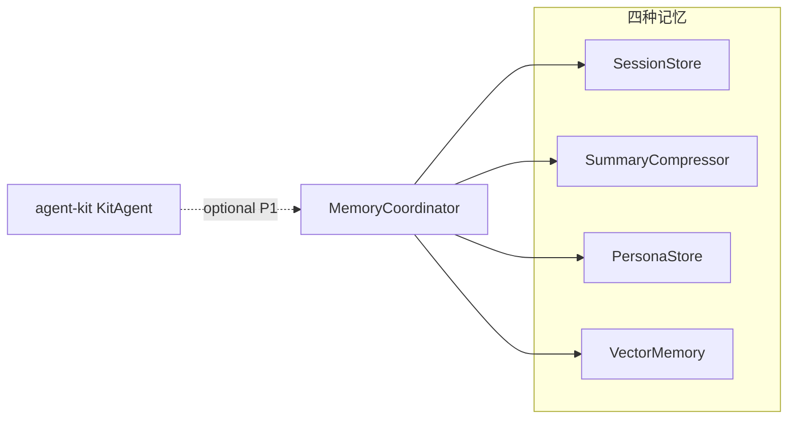

# Design: agent-memory P1

> 与 [proposal.md](./proposal.md) 同步

## 1. 架构

P0 已 SQLite 落盘；P1 不拆库，扩展 **embedding 后端** 与 **agent-kit 适配器**。

## 2. OpenAI Embedding（P1）

| 项 | 选择 |
|----|------|
| 默认 | 词袋向量（P0，离线测） |
| P1 | `VectorMemory.embed_mode=openai` + `OPENAI_API_KEY` |
| 存储 | 仍 `vector_json` 列；维度变长 list[float] |
| 回退 | API 失败 → 词袋 |

## 3. agent-kit 集成

| 项 | 选择 |
|----|------|
| 包 | `agent_kit.memory_adapter` 薄层 |
| 开关 | `AGENT_KIT_USE_COORDINATOR=1` |
| 行为 | `KitAgent.run` 前 `build_context`，拼入 `render_task` context |
| session | CLI 传入 `--session-id` 或自动 `create_session` |

不删除 P0 `SQLiteMemory`；Coordinator 为 **可选升级路径**。

## 4. CLI 增强

- `agent-memory ingest-chunk --project` 批量入库  
- `agent-memory persona-list --user`  
- `agent-memory session-resume <session_id>` 打印检查点 + 上下文  

## 5. 教材配图

`docs/images/01–05.jpg` + `docs/four-memories.md` 内嵌引用，与模块一一对应。