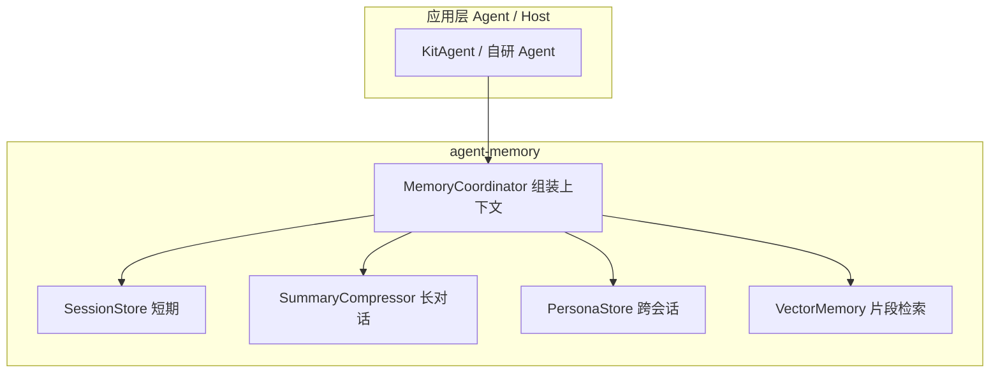

# Explore: agent-memory（第五项目 — 四种 Agent 记忆）

> **Change id:** `explore-four-memories`  
> **模式:** `/opsx:explore`  
> **教材:** 会话/检查点 · 摘要压缩 · 事实画像 · 向量检索

## 探索结论

**P0 已 apply；P1 已 propose：** 五图见 `docs/images/`。新增 `agent-memory/` 与现有四项目并列，提供 **可组合的 MemoryCoordinator**；下一步 `/opsx:apply` P1（embedding、CLI 续跑、agent-kit）。

| 记忆类型 | 教材要点 | P0 实现 |
|----------|----------|---------|
| **1 会话与任务状态** | session_id、消息、检查点、制品 | `SessionStore` + `TaskCheckpoint` |
| **2 摘要压缩** | 超预算压早期 → 目标/约束/决定/待办 | `SummaryCompressor`（规则 + 可选 LLM） |
| **3 事实与画像** | user_id、去重、更新/删除 | `PersonaStore` SQLite |
| **4 向量检索** | 分片+原文+项目+时间、筛选+相似度 | `VectorMemory` + 词袋/可选 OpenAI embedding |

**组合策略：** 下次调用上下文 = `历史摘要` + `近期消息` + `相关画像` + `检索片段` + `检查点状态`。

## 与 monorepo 分工

| 项目 | 关系 |
|------|------|
| `agent-kit` | 含简易 SQLite/向量；**可迁移** 到本仓 MemoryCoordinator |
| `langgraph-agent` | Checkpointer 管图状态；本仓管 **对话/画像/RAG 片段** |
| `multi-agent` | 执行真相；记忆不替代 Store |
| `mcp-server` | 无直接关系 |

## P1（propose 非阻塞）

- 与 `agent-kit.KitAgent` 默认注入 Coordinator  
- OpenAI embedding 默认路径、Chroma 可选  
- 摘要 LLM 质量评测集  

## 风险

| 风险 | 缓解 |
|------|------|
| 摘要丢细节 | 原始 `messages` 全量 SQLite 可回查 `session get-message <id>` |
| 词袋向量弱 | 文档标明 P0 教学用；`--embed openai` 开关 |