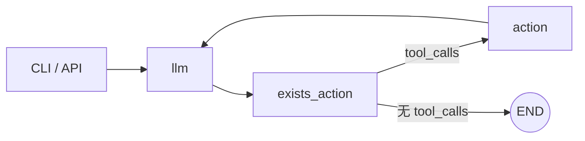

# AgentState 使用说明

本文归纳 `AgentState` 在本项目中的定义、字段含义，以及在 LangGraph、CLI/API、测试中的用法。实现见 [`src/agent/state.py`](../src/agent/state.py)。

## 角色定位

`AgentState` 是 **LangGraph `StateGraph` 的全局状态 schema**：图内所有节点共享同一份状态（运行时是普通 `dict`），每个节点：

1. 读取当前 `state` 中需要的字段；
2. 返回 **局部更新** `dict`（不必返回完整 state）；
3. 由 LangGraph 按字段规则将更新 **归约（merge）** 进全局状态。

```python
builder = StateGraph(AgentState)
```

见 [`src/agent/graph.py`](../src/agent/graph.py)。

## 字段定义

`AgentState` 使用 `TypedDict` 且 `total=False`，表示各键在类型上均可省略（适合多轮对话只传 `input`、其余从 checkpoint 恢复）。

| 字段 | 类型 | 归约方式 | 含义 |
|------|------|----------|------|
| `input` | `str` | 覆盖 | 本轮用户输入；`llm` 消费后清空，避免重复进入历史 |
| `messages` | `Annotated[list, add_messages]` | `add_messages` | 对话与工具往返（Human / AI / ToolMessage） |
| `intermediate_steps` | `list[tuple[str, str]]` | 覆盖 | 审计轨迹：`(工具名, 工具返回文本)` |
| `flags` | `dict[str, Any]` | 覆盖 | 扩展标记（如 debug、迭代上限等，预留） |

### `messages` 与 `add_messages`

`add_messages` 是 LangGraph 提供的消息列表 **reducer**（从 `langgraph.graph` 导入）：

- 节点返回的新消息会 **追加** 到已有 `messages`，而不是整表替换；
- 若新消息与某条已有消息 **同 ID**，则 **替换** 该条（流式、人机改稿等场景）；
- 支持将 dict 等形式规范为 LangChain 消息对象。

节点只需 `return {"messages": [新消息...]}`，无需自行拼接全量历史。

### `intermediate_steps`

元素为 `(name: str, content: str)`，由 `action` 节点在每次工具调用后追加，便于调试或后续展示中间步骤。当前 CLI/API 终答展示不读取该字段。

## 图中的数据流

拓扑（与架构图一致）：

```text
START → llm → exists_action ─┬→ action → llm（循环）
                            └→ END
```



### `llm` 节点（[`src/agent/nodes/llm.py`](../src/agent/nodes/llm.py)）

- **读**：`state["input"]`、`state["messages"]`
- **写**：
  - 若有非空 `input` → 加入 `HumanMessage`；
  - 调用模型后追加 `AIMessage`（可能含 `tool_calls`）
- **返回**：`{"messages": batch + [ai], "input": ""}`
- 清空 input 是为避免同一句在循环里重复进历史。

### `exists_action` 条件边（[`src/agent/edges.py`](../src/agent/edges.py)）

- **只读** `messages` 最后一条 `AIMessage`
- 存在 `tool_calls` → 路由到 `action`；否则 → `END`

### `action` 节点（[`src/agent/nodes/action.py`](../src/agent/nodes/action.py)）

- **读**：`messages[-1]` 的 `tool_calls`，以及已有 `intermediate_steps`
- **写**：每个工具结果一条 `ToolMessage`；`intermediate_steps` 追加 `(工具名, 返回)`
- **返回**：`{"messages": out_messages, "intermediate_steps": steps}`

## 入口：如何构造与传入 state

### 单轮任务（CLI `run`）

显式初始化各字段，再 `invoke`：

```python
inputs = {
    "input": task,
    "messages": [],
    "intermediate_steps": [],
    "flags": {},
}
result = graph.invoke(inputs, config)
```

见 [`src/agent/cli.py`](../src/agent/cli.py) 中 `run` 命令。

### 多轮对话（CLI `chat`、HTTP `POST /v1/chat`）

每轮只传增量，历史由 **MemorySaver + `thread_id`** 维护：

```python
graph.invoke({"input": user_line}, config)
state = graph.get_state(config).values
```

同一 `configurable.thread_id` 下，checkpoint 会保留上一轮的 `messages`、`intermediate_steps` 等。

- CLI：[`src/agent/cli.py`](../src/agent/cli.py) — `chat`
- API：[`src/agent/api.py`](../src/agent/api.py) — `/v1/chat`

终答从 **合并后的** `result["messages"]` 中取最后一条有内容的 `AIMessage`，不直接使用 `input` 或 `intermediate_steps` 作为对外输出。

### Checkpointer

`build_graph(..., checkpointer=True)` 使用 `MemorySaver`，与 CLI/API 的 `thread_id` 对应，实现会话级状态持久（进程内内存，非跨进程）。

见 [`src/agent/graph.py`](../src/agent/graph.py)。

## 类型标注约定

节点与边函数签名以 `AgentState` 标注入参，返回局部 `dict`：

```python
LlmNode = Callable[[AgentState, RunnableConfig], dict]

def take_action(state: AgentState, config: RunnableConfig) -> dict: ...
def exists_action(state: AgentState) -> Literal["action", "end"]: ...
```

测试中用字面量 dict 模拟状态，例如仅含 `messages` 测路由，见 [`tests/test_graph.py`](../tests/test_graph.py)。

## 与图示 / OpenSpec 的对应

| 设计概念 | 代码字段 |
|----------|----------|
| 用户输入 | `input` |
| 对话历史 / chat_history | `messages`（reducer：`add_messages`） |
| 中间步骤 / 观测 | `messages` 中的 `ToolMessage` + `intermediate_steps` 审计 |
| 扩展配置 | `flags` |

更完整的图与模块映射见 `openspec/changes/archive/2026-11-23-build-langgraph-agent-full-workflow/design.md`。

## 小结

1. **`AgentState` = 图的共享状态合同**，通过 `StateGraph(AgentState)` 绑定全图。
2. **`messages` 是 ReAct 循环的核心**，LLM 与 `action` 仅通过追加/替换消息协作。
3. **`input` 隔离「本轮用户句」与历史**，由 `llm` 写入 `messages` 后清空。
4. **CLI/API** 单轮可全量初始化；多轮依赖 checkpoint，通常只更新 `input`。


# ToolMessage  HumanMessage  AIMessage
# 这三个类都来自 langchain_core.messages，是 LangChain / LangGraph 里表示一条聊天上下文的标准消息类型。模型侧按「角色 + 内容」理解历史；
# Agent 图里通常放在 AgentState.messages 里，经 add_messages 合并。

# AIMessage： 表示模型（助手）的输出。若任务结束：一般是纯文本 content（终答）。若要调工具：content 可能为空或附带说明，关键是 tool_calls 列表（工具名、参数、id）。
# 条件边 exists_action 就是看最后一条 AIMessage 有没有 tool_calls，决定走 action 还是 END。

# ToolMessage：表示某次工具调用的返回（观测），不是用户也不是模型自由发挥。必须和某次 AIMessage.tool_calls 里的一条对应，
# 靠 tool_call_id（以及常带 name）对齐，下一轮 LLM 才知道「这条结果是哪个工具请求的」。
# ToolMessage(content=content, tool_call_id=tc["id"], name=name)


# HumanMessage：表示用户说的话。在本项目里，llm 会把本轮 state["input"] 转成一条 HumanMessage 再调模型
# batch.append(HumanMessage(content=user_text))

#  ReAct：想（AI）→ 做（Tool）→ 再想（AI）。
# HumanMessage("查一下明天的会")
→ AIMessage(tool_calls=[{name: "book_meeting", id: "tc1", ...}])
→ ToolMessage(tool_call_id="tc1", content="mtg-1001 ...")
→ AIMessage(content="已为您预订 …")   # 无 tool_calls → 结束


