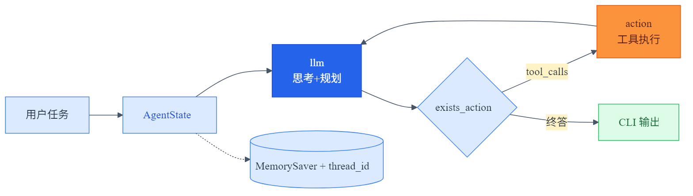
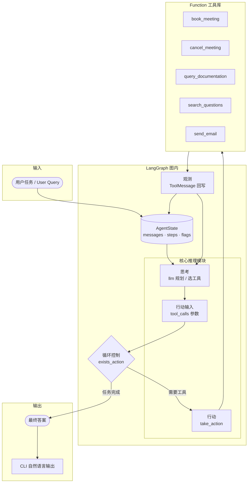
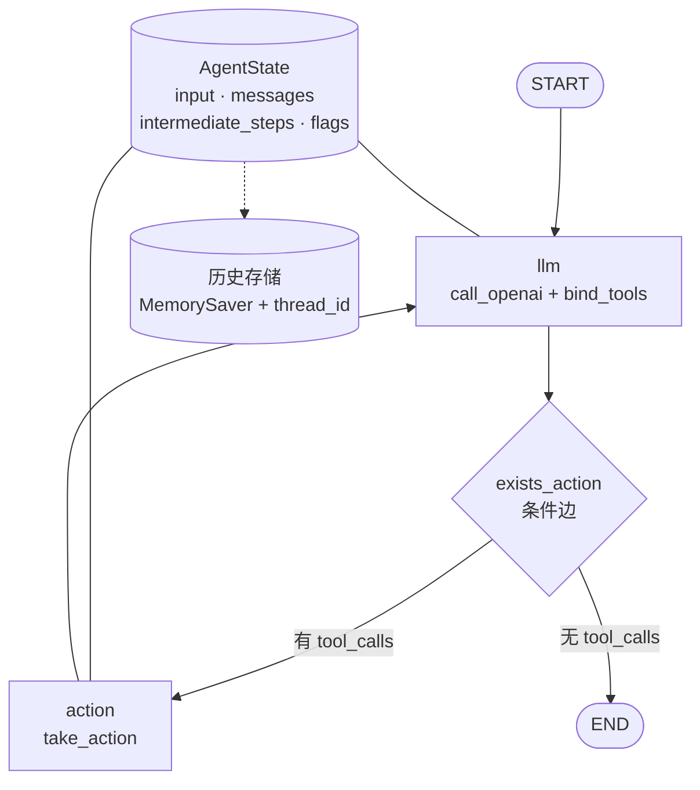
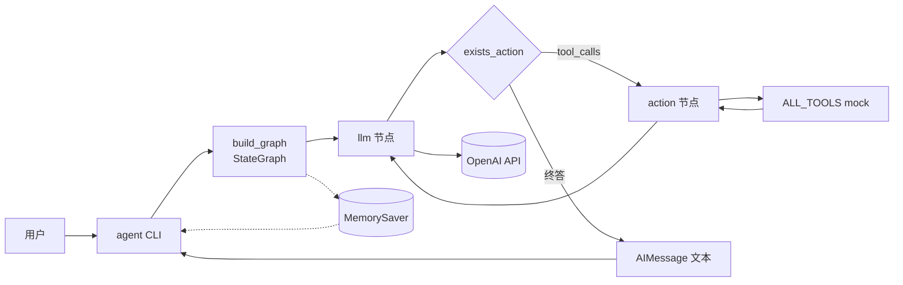

# Design: LangGraph Agent 全流程

## 0. 架构图

本节把教程中的 **全流程**、**LangGraph 执行图**、**本工程组件分层** 画在同一处，便于与下文「图示 → 代码映射」对照。

### 架构（与你的流程图一致）

本工程与探索阶段约定的主架构一致：**状态驱动一条 LLM ↔ 工具环路**，由条件边决定收尾；会话历史落在 checkpointer。



路径：`langgraph-agent/docs/assets/architecture-flow.png`

- **大脑**：OpenAI + `bind_tools`（`llm` 节点、`agent_framework`）。
- **双手**：mock 工具库 + `take_action`（`agent/tools/*`）。
- **记忆**：LangGraph checkpointer（`MemorySaver` + `thread_id`），不单独做 RAG 层。

### 0.1 端到端业务流程（用户任务 → 终答）

对应「基于 LangGraph 搭建 Agent 全流程」：状态贯穿推理环；历史可持久化；终答由 CLI 以自然语言呈现。



说明：图示中的「思考 / 行动 / 行动输入」在实现上合并为 **`llm` 节点**（产出 `tool_calls`）与 **`action` 节点**（执行并观测）；条件边对应 **继续迭代 vs 结束**。

### 0.2 LangGraph 执行图（节点 · 边 · 条件边）

对应教程 CODE 段：**蓝圈 LLM**、**橙圈 Action**、**红菱 conditional**、**黑圈 END**；状态挂在全图之外由 checkpoint 读写。



编译关系：`START → llm`；`llm → action | END`；`action → llm`（循环图）。

### 0.3 组件数据流（本工程包边界）

从包外用户到 OpenAI / mock 工具的依赖方向；虚线表示可选的会话级持久化。



### 0.4 大脑与双手（概念对照）

| 角色 | 本工程实现 | 能力 |
|------|------------|------|
| 大脑 Brain | `Agent` + `llm` + OpenAI | 规划、推理、选工具、生成终答 |
| 双手 Hands | `tools/*` + `take_action` | 按名调用 Function，返回确定性 mock 结果 |

---

## 1. 图示 → 代码映射

| 图示概念 | 实现位置 | 说明 |
|----------|----------|------|
| LangGraph 状态节点 | `agent/state.py` | `AgentState` TypedDict |
| 核心推理 · 思考 | `agent/nodes/llm.py` | `make_llm_node`：绑定 tools 的 ChatOpenAI |
| 核心推理 · 行动 | `agent/nodes/action.py` | `take_action`：解析 `tool_calls`，写 `ToolMessage` |
| 条件边 exists_action | `agent/edges.py` | 末条 AIMessage 是否含 `tool_calls` |
| Function 工具库 | `agent/tools/*` | `@tool` mock：会议/文档/搜索/邮件 |
| 历史存储 | `graph.build_graph(checkpointer=True)` | `MemorySaver` + `thread_id` |
| Agent 框架 / system | `agent/agent_framework.py` | `Agent` 类 + `default_agent()` |
| 图编译 | `agent/graph.py` | `StateGraph` 注册节点与边 |
| 呈现层（CLI） | `agent/cli.py` | Typer：`run` / `chat` / `new-thread` |

## 2. 状态设计

```python
class AgentState(TypedDict, total=False):
    input: str                    # 本轮用户任务（可选，chat 可只追加 HumanMessage）
    messages: Annotated[list, add_messages]  # LangGraph 消息 reducers
    intermediate_steps: list[tuple[str, str]]  # (tool_name, result) 审计轨迹
    flags: dict[str, Any]         # 扩展：最大步数、调试开关等
```

- **chat_history**：不单独字段；由 `messages` + checkpointer 表示（与 LangChain/LangGraph 惯例一致）。
- 图示「观测」合并在 **action 节点**：工具返回值进入 `ToolMessage`，下一轮 LLM 读取。

## 3. 图结构（与教程 CODE 段一致）

执行图与状态挂载见 **§0.2**。

编译代码（已有骨架）：

- `START → llm`
- `llm` 条件边 → `action` 或 `END`
- `action → llm`（循环）

## 4. Agent 框架

```python
class Agent:
    def __init__(self, system: str = "", model: str = "gpt-4o-mini", temperature: float = 0):
        self.system = system
        self.model = model
        self.temperature = temperature
```

`default_agent()` 返回中文友好秘书角色 system prompt，并声明可用工具的使用准则。

LLM 节点行为：

1. 将 `state["input"]`（若有）转为 `HumanMessage` 并入 `messages`。
2. `SystemMessage(self.system)` + 历史 `messages` 调用 `bind_tools(ALL_TOOLS)`。
3. 返回 `{"messages": [AIMessage]}`。

## 5. 工具库（mock）

| 工具名 | 文件 | 图示能力 |
|--------|------|----------|
| `book_meeting` | `tools/meetings.py` | 预订会议 |
| `cancel_meeting` | `tools/meetings.py` | 取消会议 |
| `query_documentation` | `tools/docs.py` | 查询文档 |
| `search_questions` | `tools/search.py` | 搜索问题 |
| `send_email` | `tools/email.py` | 发送邮件 |

`ALL_TOOLS` 在 `tools/__init__.py` 聚合，供 LLM bind 与 action 查找。

## 6. 条件边语义

`exists_action(state)`：

- 无 `messages` → `end`
- 最后一条为 `AIMessage` 且 `tool_calls` 非空 → `action`
- 否则 → `end`（模型已给出最终自然语言答案）

可选增强（tasks 中标记为 P2）：`flags` 中 `max_iterations` 防止无限环。

## 7. CLI 与 checkpoint

| 命令 | 行为 |
|------|------|
| `agent run <task>` | 初始化 state，单次 `invoke`，打印最后 AI 文本 |
| `agent chat` | REPL；每轮 `invoke({"input": line})`，同 `thread_id` |
| `agent new-thread` | 输出 UUID 供隔离会话 |

`configurable.thread_id` 传入 `graph.invoke/stream`；历史由 checkpointer 读写。

环境变量（`.env.example`）：

- `OPENAI_API_KEY`（必需）
- 可选 `OPENAI_MODEL` 覆盖默认模型

## 8. 工程布局

```
langgraph-agent/
├── pyproject.toml
├── README.md
├── .env.example
├── openspec/changes/build-langgraph-agent-full-workflow/
├── src/agent/
│   ├── __init__.py
│   ├── state.py
│   ├── agent_framework.py
│   ├── graph.py
│   ├── edges.py
│   ├── cli.py
│   ├── nodes/
│   │   ├── __init__.py
│   │   ├── llm.py
│   │   └── action.py
│   └── tools/
│       ├── __init__.py
│       ├── meetings.py
│       ├── docs.py
│       ├── search.py
│       └── email.py
└── tests/
    └── test_graph.py
```

`pyproject.toml`：`[project.scripts] agent = "agent.cli:app"`。

## 9. 测试策略

- **单元**：`exists_action` 路由；`take_action` mock 工具输出（已有测试，需 `meetings` 模块补齐后保持绿）。
- **集成**（可选 P2）：`@pytest.mark.integration` + 真实 API，CI 默认跳过。

## 10. 后续扩展（不在本 change）

- Postgres/SQLite checkpointer、LangGraph Studio 导出
- 独立 `observe` 节点（若需把「观测」从 action 拆出）
- RAG 记忆层、子图嵌套（多 Agent）