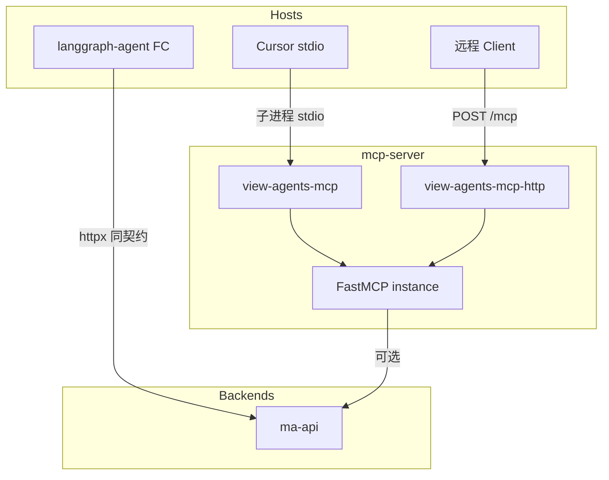

# Design: MCP Server P1

> 与 [proposal.md](./proposal.md) 同步

## 1. 架构



**单进程双入口：** `server.py` 导出唯一 `mcp = FastMCP(...)`；`stdio` / `http` 仅启动方式不同。

## 2. HTTP 传输（P1）

| 项 | 选择 |
|----|------|
| API | `FastMCP.run_http_async(transport="streamable-http")` |
| 默认 | `127.0.0.1:8010`，path `/mcp` |
| 环境变量 | `FASTMCP_HOST`、`FASTMCP_PORT`、`FASTMCP_STREAMABLE_HTTP_PATH` |
| 无状态 | `stateless_http=true` 默认可配置（对齐 MCP 2026 取向） |

```python
# http_entry.py
async def run_http():
    await mcp.run_http_async(
        host=os.getenv("FASTMCP_HOST", "0.0.0.0"),
        port=int(os.getenv("FASTMCP_PORT", "8010")),
        transport="streamable-http",
        path=os.getenv("FASTMCP_STREAMABLE_HTTP_PATH", "/mcp"),
        show_banner=True,
    )
```

**日志：** uvicorn 访问日志；应用日志仍 **stderr**。

## 3. OAuth 路线图（文档 + 钩预留）

| Phase | 名称 | P1 交付 |
|-------|------|---------|
| **0** | Dev Bearer | `MCP_HTTP_BEARER_TOKEN` 可选；HTTP 中间件校验（未设则仅监听 localhost 警告） |
| **1** | Static API Key | 与 `MULTI_AGENT_ACCESS_TOKEN` 分离；Header `Authorization: Bearer` |
| **2** | OAuth 2.1 | `WWW-Authenticate` 元数据、scope→tools 裁剪（设计见 `oauth-roadmap.md`） |
| **3** | 集中 IdP | 与公司 SSO 对接；非 P1 |

P1 **实现 Phase 0 可选 Bearer**；Phase 2 仅文档与 `FastMCP.auth` 扩展点调研。

## 4. LangGraph ↔ MCP 契约统一

**单一事实源：** `contracts/multi_agent_tools.json`

| 字段 | 用途 |
|------|------|
| `name` | MCP tool 名 = LangGraph `@tool` 名 |
| `description` | 模型可读（MCP `tools/list`） |
| `inputSchema` | JSON Schema |
| `maps_to` | `POST /v1/...` 或 `internal` |

**LangGraph P1：** `agent/tools/multi_agent.py` 三个 stub：

- `multi_agent_create_workflow`
- `multi_agent_submit_proposal`
- `multi_agent_health`

实现：`httpx` → `MULTI_AGENT_API_URL`（与 MCP bridge 相同 JSON body），**不** import `view_agents_mcp`。

**注册策略：** `ALL_TOOLS` 默认保持办公 mock；`USE_MULTI_AGENT_TOOLS=1` 时 append multi_agent tools（不破坏现有 pytest）。

## 5. 协议测试策略

使用 `fastmcp.utilities.tests.asgi_server(mcp)`：

```text
test_list_resources → URI 包含 execution-summary
test_read_resource → markdown 含 business_key
test_list_prompts → refund-after-sale-assist
test_get_prompt → messages 含 create_workflow 指引
test_http_health_smoke → 可选 run_server_async 短连接
```

不启动真实 8010 端口矩阵测试（Windows CI 友好优先 in-process ASGI）。

## 6. 目录增量

```text
mcp-server/
  contracts/multi_agent_tools.json
  docs/oauth-roadmap.md
  docs/langgraph-mcp-contract.md
  src/view_agents_mcp/http_entry.py
  tests/test_mcp_protocol.py
langgraph-agent/
  src/agent/tools/multi_agent.py   # P1 optional
  contracts/ → symlink 或复制说明在 doc
```

## 7. 安全（延续 explore）

- HTTP 暴露时 **必须** 文档强调 Bearer / 反向代理 TLS  
- `submit_proposal` 保持 readOnly annotations  
- Server 校验 JSON Schema（FastMCP strict 可选 P2）