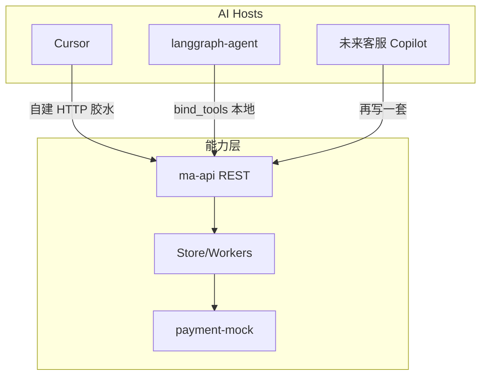
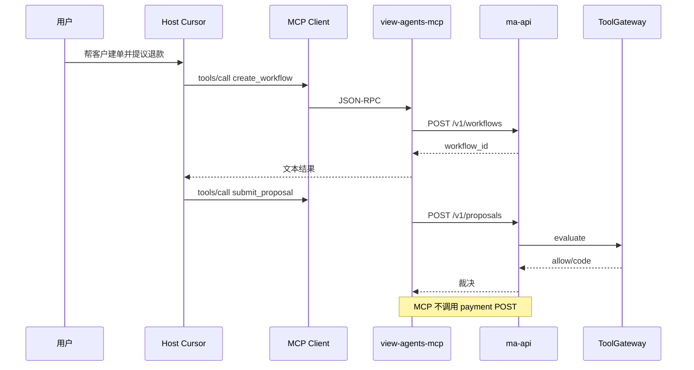

# Explore: view-agents MCP Server（并列第三项目）

> **Change id:** `explore-mcp-bridge`  
> **模式:** `/opsx:explore`  
> **问卷:** 通用骨架 · Python FastMCP · stdio · 含 MCP 教学与使用经验

## 探索结论

**建议进入 `/opsx:propose`：** 在既有 P0 骨架上补齐 Resources/Prompts、Tool Annotations、文档与远程 HTTP 路线图；**不阻塞** `langgraph-agent` / `multi-agent`。

教学与场景：

- [`../../../docs/mcp-fundamentals.md`](../../../docs/mcp-fundamentals.md) — M×N、FC vs MCP、三原语、信任边界、stdio/HTTP  
- [`usage-scenarios.md`](./usage-scenarios.md) — A–G 七种使用经验与踩坑

---

## 1. MCP 在本 monorepo 中的定位

### 1.1 问题：无 MCP 时的 M×N



**MCP 方案：** `mcp-server` 实现 **一次** Server；各 Host 的 MCP Client 复用 `tools/list` + `tools/call`。

### 1.2 三项目并列分工

| 项目 | 层次 | MCP 关系 |
|------|------|----------|
| `langgraph-agent` | 演示 ReAct + FC | 工具应映射到 proposal API，与 MCP tools **同契约** |
| `multi-agent` | 真相 + Gateway + Worker | `ma-api` = Server 底层 REST |
| `mcp-server` | 标准工具面 | **弱耦合** HTTP 桥接；stdio 给 Cursor |

### 1.3 MCP vs Function Calling（本仓库实例）

| 环节 | langgraph-agent | Cursor + MCP |
|------|-------------------|--------------|
| Schema 来源 | `ALL_TOOLS` + `bind_tools` | MCP `tools/list` → Host 转 FC |
| 执行 | `take_action` 进程内 | `view-agents-mcp` → `httpx` → `ma-api` |
| 状态真相 | `messages` | **multi-agent Store**（非 MCP） |

---

## 2. 架构与协议映射

### 2.1 全流程（提议不退款）



### 2.2 三种原语路线图

| 原语 | P0 explore | P1 propose |
|------|------------|------------|
| **Tools** | ping、info、health、workflow、proposal | 审计字段、annotations 全覆盖 |
| **Resources** | 协议摘要、Gateway 代码表 URI | 订阅 docx 变更（可选） |
| **Prompts** | `refund-after-sale-assist` 模板 | 审校 / walkthrough 变体 |

### 2.3 传输层

| 阶段 | 模式 | 说明 |
|------|------|------|
| **P0** | stdio | Cursor 子进程；env 注入密钥 |
| **P2** | Streamable HTTP | 团队 URL + OAuth 2.1；参考 Vercel MCP 四要素 |

**stdio 纪律：** 日志仅 stderr（见 [`usage-scenarios.md`](./usage-scenarios.md) 踩坑表）。

---

## 3. 工具清单与安全

完整参数见 [`tool-catalog.md`](./tool-catalog.md)。

### 3.1 禁止清单（全阶段）

- MCP 内 `PaymentClient.post_refund` 或支付 Mock 写接口  
- 绕过 Gateway 直接改 Store  
- 将 `destructiveHint: false` 当作 Host 免确认依据  

### 3.2 信任边界（退款域）

- **Host 不信任 Server：** 校验返回 JSON、关键操作二次确认  
- **Server 不信任 Client：** `access_token`、金额上限、tool 枚举  
- **无状态：** `workflow_id` 由 Client 每次显式传递（协议 2026-07-28 取向）

### 3.3 Agent / Skill / MCP / CLI

| 需求 | 选型 |
|------|------|
| 固定回归步骤 | OpenSpec tasks、`ma-walkthrough` |
| IDE 动态查 workflow | MCP tools |
| 批量门禁 | `pytest`、`scripts/fault_drill/run_all.py` |
| LLM 环内工具 | `langgraph-agent` 或 Host FC |

---

## 4. 目录结构

```text
view-agents/
  langgraph-agent/
  multi-agent/
  mcp-server/
    src/view_agents_mcp/    # FastMCP Server
    docs/mcp-fundamentals.md
    docs/resources/         # Resource 静态正文
    openspec/changes/explore-mcp-bridge/
      explore.md            # 本文件
      usage-scenarios.md
      tool-catalog.md
```

---

## 5. 技术选型（已定）

| 项 | 选择 |
|----|------|
| 语言 | Python ≥3.10 |
| 框架 | FastMCP |
| 默认传输 | stdio |
| 桥接 | `httpx` → `ma-api` |

---

## 6. 开放问题（propose 拍板）

1. 是否在 P1 提供 FastMCP `http_app` 样板 + 反向代理文档？  
2. LangGraph 官方 tool 是否 **直接读 MCP**（stdio 子进程）还是 **仅 HTTP 对 ma-api**？  
3. Resource 是否嵌入 `multi-agent/docx` 图片元数据（或仅 markdown 摘要）？  
4. OAuth / 多租户 scope 表是否与 `TENANT_QUOTA` 对齐？

---

## 7. 参考资料（用户指定）

| 资料 | URL |
|------|-----|
| MCP 规范 2026-07-28 | https://modelcontextprotocol.io/specification/2026-07-28/basic |
| TypeScript SDK v2 | https://ts.sdk.modelcontextprotocol.io/v2/index.html |
| Anthropic 公告 | https://www.anthropic.com/research/model-context-protocol |
| Vercel MCP | https://vercel.com/docs/mcp |

---

## 下一步

- **已 propose：** [proposal.md](./proposal.md)、[design.md](./design.md)、[specs.md](./specs.md)、[tasks.md](./tasks.md)  
- **apply：** 按 `tasks.md` P1 勾选验收