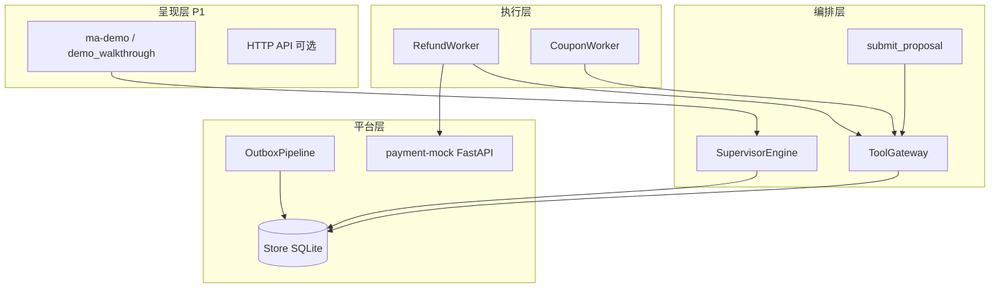

# Design: Python 状态机仿真（生产协议参考实现）

> **Status:** `propose`（与 [proposal.md](./proposal.md) 同步）  
> 配图：`../../docx/`

## 1. 架构总览



远期对照（P2）：Ingest/Worker 进程拆分 → Kafka；Store → PostgreSQL；同 schema。

## 2. 目录结构（当前 + P1）

```text
multi-agent/
├── src/multi_agent/
│   ├── domain.py           # business_key, enums
│   ├── state_machine.py    # 转移表
│   ├── store.py            # 持久化 + 租约/fencing
│   ├── gateway.py          # Tool Gateway
│   ├── proposals.py        # 提议入口
│   ├── engine.py           # Supervisor
│   ├── workers/
│   ├── outbox.py
│   ├── metrics.py          # P1: 扩展 + HTTP /metrics
│   ├── payment/
│   │   ├── server.py       # 全功能 Mock
│   │   └── client.py
│   ├── fault_drill/
│   └── demo.py
├── tests/
├── scripts/fault_drill/
├── docs/
├── docx/
└── openspec/changes/.../
```

## 3. 数据模型（SQLite）

见 `store.py` schema：`workflows`, `tasks`, `tool_operations`, `outbox_events`, `audit_log`, `consumed_events`。

**P1 扩展：**

- `workflows.status = NEEDS_REVIEW` 与人工 API
- `reconciliation_jobs` 表（可选）记录对账批次

## 4. 关键流程

### 4.1 退款（含超时）

与文图 08 一致：PENDING → POST → 504 → UNKNOWN → GET → SUCCEEDED → promote coupon。

### 4.2 发券

DAG 门（`try_promote_coupon_after_refund`）+ Gateway 门（`coupon.issue` + T03_DEP）。

### 4.3 提议与裁决

Agent/LLM 只构造 `Proposal` → `submit_proposal` → Worker 在 allow 后执行。

## 5. 支付 Mock 设计

详见 [docs/payment-gateway-mock.md](../../../docs/payment-gateway-mock.md)。

**P1 增强规划：**

- `POST /v1/refunds` 校验租户额度（内存配额表）
- 审批快照 ID 与 workflow 联动校验
- OpenAPI 导出 + 契约测试

## 6. 测试分层

| 层 | 内容 |
|----|------|
| 单元 | `state_machine`, `gateway` T03, payment mock |
| 集成 | E2E refund+coupon, fencing |
| 演练 | `fault_drill` 五场景 |
| P1 | metrics 断言、outbox 专项、walkthrough smoke |

## 7. 与 langgraph-agent

| langgraph-agent | multi-agent |
|-----------------|-------------|
| `AgentState.messages` | `Store` 行级真相 |
| `take_action` 同步 | Worker + 租约 |
| `@tool` mock | payment-mock HTTP |
| 无 UNKNOWN | UNKNOWN + reconcile |

**P2：** LangGraph 节点只调 `submit_proposal` / 触发 workflow id，不直写支付。

## 8. 实现保证

[slide-implementation-matrix.md](./slide-implementation-matrix.md) + [specs.md](./specs.md) + [tasks.md](./tasks.md)。

**apply 顺序：** P0 扫尾 → P1 可观测/NEEDS_REVIEW/walkthrough → P2 按需。