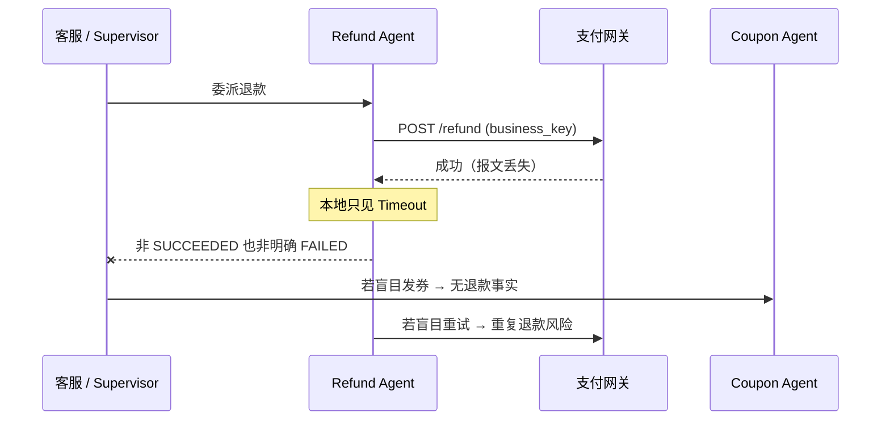

# Explore: 生产级 Multi-Agent 可恢复执行协议

> **Change id:** `explore-production-refund-multi-agent`  
> **模式:** `/opsx:explore`（只产出方向与文档，不写 Go 业务代码）

## 问题陈述



幻灯片：`../../docx/02-refund-response-lost-timeout.jpg`

## 探索结论（是否立项）

**建议立项**：与 `langgraph-agent` 形成 **演示 vs 生产** 对照；本仓承载 **执行协议与状态机**，LangGraph 仓可后续仅做「提议动作」适配层。

## 核心对象模型（四层身份）

| 层级 | 标识 | 语义 |
|------|------|------|
| Workflow | `workflow_id` | 一次客服工单级流程 |
| Task | `task_id` + `logical_step_key` | DAG 节点（refund / coupon） |
| Attempt | `attempt_no` | 本次领取执行的次数 |
| Tool operation | `business_key` | 外部写入幂等键（租户·工具·订单·售后） |

**规则：** 重试换 Attempt，**business_key 不变**。见 `docx/04-business-key-not-task-id.jpg`。

## Task 状态机（必须含 UNKNOWN）

```text
WAITING → READY → CLAIMED → RUNNING → SUCCEEDED
                                    → FAILED
                                    → UNKNOWN →（远端查询 | 对账 | 人工）
```

- 租约：`owner` + `lease_until` + `version`（乐观锁 / fencing）
- UNKNOWN 收敛后才允许依赖门把发券 Task 置为 READY。见 `docx/05-unknown-formal-state.jpg`。

## 退款超时路径（08 图）

1. 先持久化 `tool_operation=PENDING`
2. 携带 `business_key` 调网关
3. 响应丢失 → `UNKNOWN`（非 FAILED）
4. 按 `business_key` 查询远端 → `CONFIRMED` 或进入对账/人工

## 发券前两道门（09 图）

| 门 | 职责 |
|----|------|
| DAG 依赖门 | 上游 Task=SUCCEEDED 且结果版本有效 → 下游 READY |
| Tool Gateway | 租户、额度、审批快照、工作流态、再授权 |

## 可靠交接（06 图）

同一事务写入：**Task 行 + workflow version + Outbox event** → Publisher → Kafka → Ingest → 队列表。  
原则：**允许事件重复，不允许任务丢失**。

## 与 langgraph-agent 的集成设想（后续 change）

| langgraph-agent | multi-agent |
|-----------------|-------------|
| LLM `tool_calls` 提议 `refund.create` | Tool Gateway 裁决是否允许写入 |
| `messages` 历史 | 不作为真相源 |
| `action` 同步 invoke | Worker 异步 + 状态回写 |

## 开放问题（propose 前需拍板）

1. **MVP 语言**：先 Go monorepo，还是 Python 仿真状态机 + Go 仅 Gateway？
2. **支付网关**：纯 mock + 可编程丢包 / 延迟，还是接沙箱 API？
3. **UNKNOWN 自动收敛**：仅轮询查询，还是引入对账批处理？
4. **与 view-agents 仓库**：独立 git 根还是 `view-agents` 单 mono-repo？

## 实现保证（用户确认）

**11 张配图中的技术必须全部实现**，验收以 [slide-implementation-matrix.md](./slide-implementation-matrix.md) 为准。

## 状态

探索已收敛至 **`/opsx:propose`**：

- [proposal.md](./proposal.md) — 范围 P0/P1/P2
- [specs.md](./specs.md) — 可测试需求
- [design.md](./design.md) — Python 仿真架构
- [tasks.md](./tasks.md) — apply 顺序

## 下一步

**`/opsx:apply`**：按 `tasks.md` P0 扫尾 → P1 归档门禁。